

<picture><source media="(prefers-color-scheme: dark)" srcset="readme/dark/header.svg"/></picture>

<a href="https://dileepapeiris.is-a.dev"><picture><source media="(prefers-color-scheme: dark)" srcset="https://img.shields.io/badge/PORTFOLIO-161b22?style=for-the-badge&logo=vercel&logoColor=e6edf3"/></picture></a>
<a href="https://x.com/dileepa_dev"><picture><source media="(prefers-color-scheme: dark)" srcset="https://img.shields.io/badge/X-161b22?style=for-the-badge&logo=x&logoColor=e6edf3"/></picture></a>
<a href="mailto:dileepapeiris5@gmail.com"><picture><source media="(prefers-color-scheme: dark)" srcset="https://img.shields.io/badge/EMAIL-161b22?style=for-the-badge&logo=gmail&logoColor=e6edf3"/></picture></a>
<a href="https://github.com/dileepapeiris"><picture><source media="(prefers-color-scheme: dark)" srcset="https://img.shields.io/badge/GITHUB-161b22?style=for-the-badge&logo=github&logoColor=e6edf3"/></picture></a>

<picture><source media="(prefers-color-scheme: dark)" srcset="readme/dark/about.svg"/></picture>

<picture><source media="(prefers-color-scheme: dark)" srcset="readme/dark/route.svg"/></picture>

<a href="https://github.com/expo/expo/pulls?q=is%3Apr+author%3Adileepapeiris"><picture><source media="(prefers-color-scheme: dark)" srcset="readme/dark/expo.svg"/></picture></a>

<a href="https://android-review.googlesource.com/c/platform/frameworks/support/+/4389664"><picture><source media="(prefers-color-scheme: dark)" srcset="readme/dark/androidx.svg"/></picture></a>

<a href="https://github.com/wso2-open-operations/cs-tools/pulls?q=is%3Apr+author%3Adileepapeiris"><picture><source media="(prefers-color-scheme: dark)" srcset="readme/dark/portal.svg"/></picture></a>

<a href="https://github.com/opensuperapp/opensuperapp/pulls?q=is%3Apr+author%3Adileepapeiris"><picture><source media="(prefers-color-scheme: dark)" srcset="readme/dark/superapp.svg"/></picture></a>

<picture><source media="(prefers-color-scheme: dark)" srcset="readme/dark/con.svg"/></picture>

<picture><source media="(prefers-color-scheme: dark)" srcset="readme/dark/at_wso2.svg"/></picture>

<a href="https://github.com/pulls?q=is%3Apr+author%3Adileepapeiris"><picture><source media="(prefers-color-scheme: dark)" srcset="readme/dark/more.svg"/></picture></a>

<picture><source media="(prefers-color-scheme: dark)" srcset="readme/dark/contributions.svg"/></picture>

<picture><source media="(prefers-color-scheme: dark)" srcset="readme/dark/stack.svg"/></picture>

<picture><source media="(prefers-color-scheme: dark)" srcset="readme/dark/footer.svg"/></picture>
